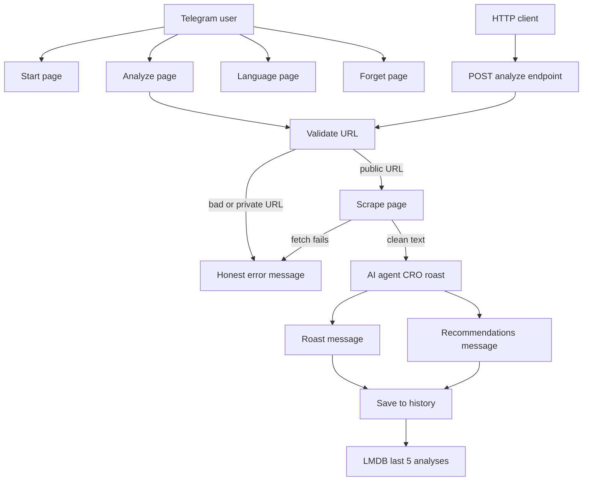

# bot-analyze-landing-page-ai

A production-ready Telegram bot built with [Gramstax](https://github.com/gramstax/gramstax): declarative pages, template-driven messages, and end-to-end tested flows.

Page Roast roasts your landing page with AI. Paste any URL — on Telegram or through the HTTP endpoint — and get a blunt, friendly CRO roast plus exactly 10 specific optimization tips. It works in English or Indonesian, remembers your last 5 analyses, and never fakes an analysis when a page cannot be fetched.

The generated project is Bun-only: `gramstax start`, the test suite, and the build all run on Bun.


> 🚀 **Need a custom Telegram bot?** I build Telegram bots with Gramstax — text, voice, AI agents, and integrations, tailored to your workflow. Talk to me on Telegram: [@damartripamungkas](https://t.me/damartripamungkas).

## Features

- 🧩 **Page-based routing**: each screen is a class with `show`/`process` steps, inline keyboards, and session state
- 🎨 **Template engine**: rich HTML messages, filters, media groups, and multi-language variants
- 🔍 **Real scraper, not a demo string**: the bot fetches the page you send, strips scripts and styles, and hands clean text to the AI
- 🤖 **AI CRO agent**: a professional conversion-rate expert who roasts the page and gives exactly 10 specific, personalized, easy-to-implement optimization ideas — no generic filler
- 🌐 **HTTP endpoint**: `POST /analyze` returns the same roast and 10 tips as JSON, for scripts and other services
- 🛡️ **SSRF guard**: only public http/https URLs are fetched — localhost, private networks, and metadata addresses are refused
- 💬 **Recent history**: your last 5 analyses are kept in LMDB; `/forget` wipes them
- ✅ **E2E tested**: in-process harness asserts every Telegram API call (`e2e/` mirrors `src/pages/`)
- 🛡️ **Guards, throttling & metrics**: route guards, rate limits, and a status server out of the box

## Flow



## Quick Start

```bash
bun install
cp .env.example .env   # fill BOT_TOKEN and OPENAI_API_KEY (see Configuration)
bun run dev            # gramstax start — Telegram bot (polling)
bun run serve          # HTTP endpoint on ANALYZE_PORT (default 3002)
```

Send `/analyze https://yuzuu.co` to the bot, or just paste the URL in the chat. The bot shows a typing indicator while it fetches the page and asks the AI, then replies with the roast followed by the 10 recommendations.

## HTTP Endpoint

The same analysis is available over HTTP — no Telegram needed:

```bash
curl -X POST http://127.0.0.1:3002/analyze \
  -H "Content-Type: application/json" \
  -d '{"url": "https://yuzuu.co"}'
```

Success (200):

```json
{
  "url": "https://yuzuu.co",
  "host": "yuzuu.co",
  "title": "Yuzuu — ...",
  "roast": "...",
  "recommendations": ["...", "..."],
  "via": "openai"
}
```

`recommendations` has up to 10 items on success (exactly 10 when the model returns a complete reply — the parser never invents items, so a truncated provider reply yields fewer). Failure returns `{"error": "<code>"}` with status 400 (`url-required`, `invalid-url`, `blocked-host`) or 502 (`fetch-error`, `ai-error`).

The endpoint is unauthenticated by design — run it on localhost or behind your own reverse proxy. It stores nothing; the Telegram bot keeps the per-user history.

`GET /health` returns `{"ok": true}`. `GET /` describes the service.

## Scripts

| Script | Description |
| --- | --- |
| `bun run dev` | Start the bot in development mode (`gramstax start`) |
| `bun run start` | Start the bot (`gramstax start`) |
| `bun run serve` | Start the HTTP endpoint (`src/server.ts`) |
| `bun run build:gramstax` | Build the project (`gramstax build`) |
| `bun run typecheck` | Type-check the project (`tsc --noEmit`) |
| `bun run test` | Run unit tests (`bun test test/`) |
| `bun run test:e2e` | Run end-to-end tests (`bun test e2e/`) |
| `bun run test:all` | Run unit + e2e tests |
| `bun run test:e2e:check` | Type-check the e2e harness |

## Project Structure

```
.
├── references/        # Original workflow JSON (reference only)
├── src/
│   ├── blocks/        # Reusable template blocks (keyboard)
│   ├── core/          # BotCore: AllowList guard, bot setup
│   ├── db/            # LMDB schemas + repositories (user, analyses)
│   ├── helpers/       # Logging
│   ├── lib/           # Config, OpenAI client, scraper, analyzer, language
│   ├── pages/         # start, analyze, help, language, forget, status
│   ├── types/         # Shared types grouped by domain: user, analyze, page
│   └── server.ts      # HTTP endpoint (Bun.serve)
├── e2e/               # E2E tests mirroring src/pages/ + coverage ledger
└── test/              # Unit tests (scraper, analyzer, openai, config, server)
```

## Configuration

Copy `.env.example` to `.env`:

| Variable | Default | Description |
| --- | --- | --- |
| `BOT_TOKEN` | — | Telegram bot token from @BotFather (required for the bot) |
| `OPENAI_API_KEY` | — | OpenAI API key. Optional when `OPENAI_BASE_URL` points at a keyless OpenAI-compatible provider (see below) |
| `OPENAI_BASE_URL` | `https://api.openai.com/v1` | AI provider base URL — any OpenAI-compatible API works |
| `OPENAI_MODEL` | `o1` | Model name. The original flow used `o1` with high reasoning effort |
| `OPENAI_REASONING_EFFORT` | — | `low`, `medium`, or `high`. Sent only to reasoning models (o1/o3/o4); ignored otherwise |
| `ANALYZE_PORT` | `3002` | Port for the HTTP endpoint (`bun run serve`) |
| `ANALYZE_ALLOWED_IDS` | — | Comma-separated Telegram user IDs allowed to use the bot (empty = everyone) |
| `ANALYZE_MOCK_AI` | — | `1` forces the deterministic mock analyzer (used by the e2e tests) |
| `BOT_DEPLOY` | `polling` | `polling` or `webhook` |

### AI provider without a key

Any OpenAI-compatible API works. A free one that needs no key is [Pollinations](https://pollinations.ai): set `OPENAI_BASE_URL=https://text.pollinations.ai/openai` and `OPENAI_MODEL=openai-fast` (the `openai` model often rate-limits with 402 FREE_LIMIT, one reply per 45 seconds per IP; `openai-fast` is the reliable one). With a custom base URL and no key, the bot runs live instead of falling back to mock mode — the mock only applies when the base URL is the OpenAI default and no key is set.

### Reasoning models

`o1` (the default) is a reasoning model: the client omits `temperature` and sends `reasoning_effort` only when `OPENAI_REASONING_EFFORT` is set. Non-reasoning models get `temperature` 0.7 and no reasoning parameters, so generic providers keep working.

### SSRF guard

Before fetching, the URL is validated: only `http:`/`https:` schemes, and the hostname must not be localhost, a private/reserved range, or a `.local` name. The hostname is also DNS-resolved and the result re-checked against private ranges, so a public-looking name cannot smuggle a private address. Blocked URLs are refused with an honest message — the bot never analyzes a page it did not fetch.

### Memory

The original flow has no memory node — each analysis stands alone. This bot keeps only two things in LMDB: your language preference (`UserSchema.botLang`) and your last 5 analyses (`AnalysisSchema`, newest first). `/forget` deletes the analyses; it does not change your language.

## Testing

```bash
bun run test:all        # unit + e2e
bun run test:e2e:check  # type-check the e2e harness
```

Unit tests cover URL validation and the SSRF guard, HTML-to-text extraction, roast/recommendation parsing, the reasoning-model request shape, config defaults, and the HTTP endpoint (mock mode). E2E tests run the real bot in-process with mocked AI and assert every Telegram API call: `/analyze` with a URL returns a roast + exactly 10 recommendations, `/language` switches EN/ID, invalid and localhost URLs get honest errors, and `/forget` clears the history. See `e2e/COVERAGE.md` for the coverage ledger.

## Deployment

Run `bun run build` to verify the project, then start with `bun run start` (Telegram bot) and `bun run serve` (HTTP endpoint) — two separate processes, both Bun. The LMDB data directory defaults to `./data` (see `src/db/index.ts`). Keep `.env` out of version control; never commit a real `BOT_TOKEN` or `OPENAI_API_KEY`.

## Tech Stack

- [Gramstax](https://github.com/gramstax/gramstax) 6.1.0 — Telegram bot framework
- [@gramstax/lmdb](https://www.npmjs.com/package/@gramstax/lmdb) 6.1.0 — LMDB storage
- [Bun](https://bun.sh) — runtime, test runner, and HTTP server
- TypeScript — strict mode
- OpenAI-compatible chat completions API (default model `o1`)

## License

MIT — see [LICENSE](LICENSE).
